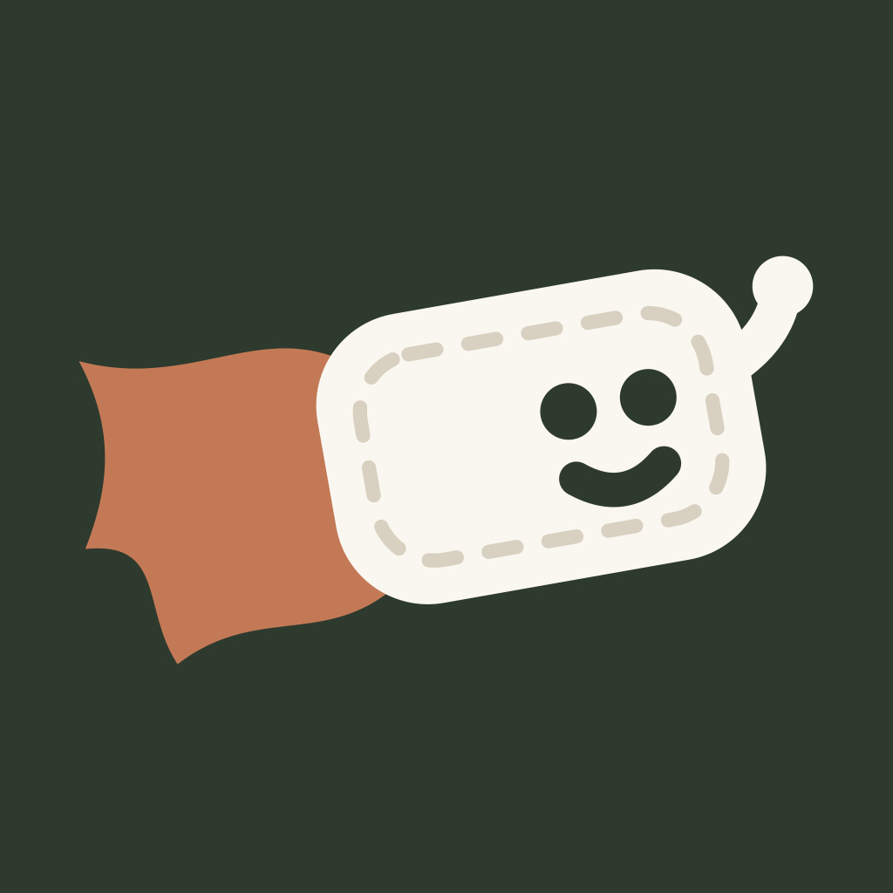
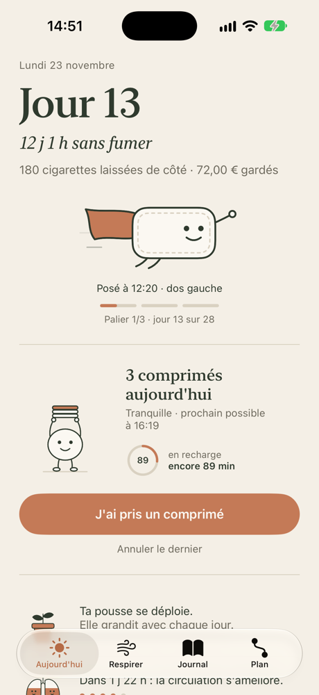
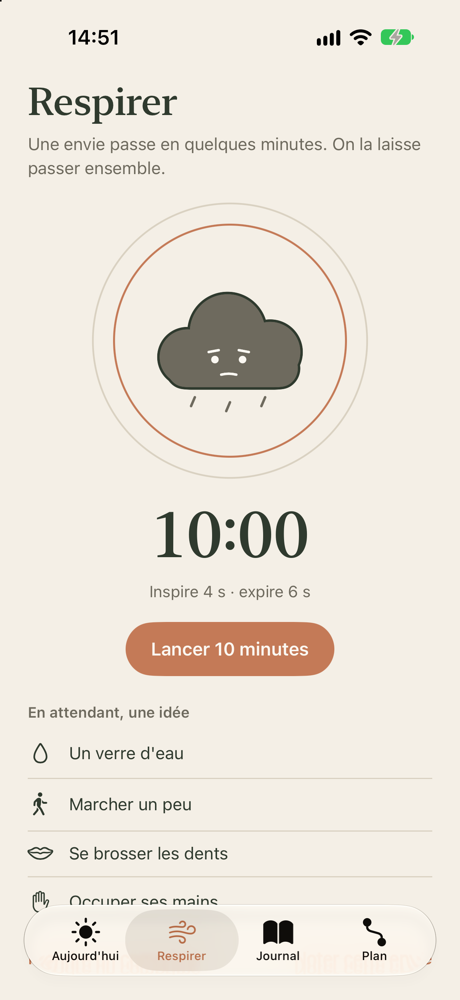
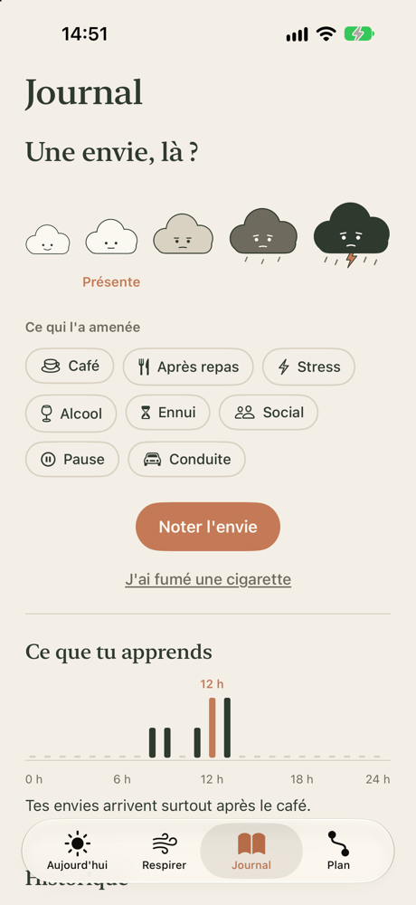
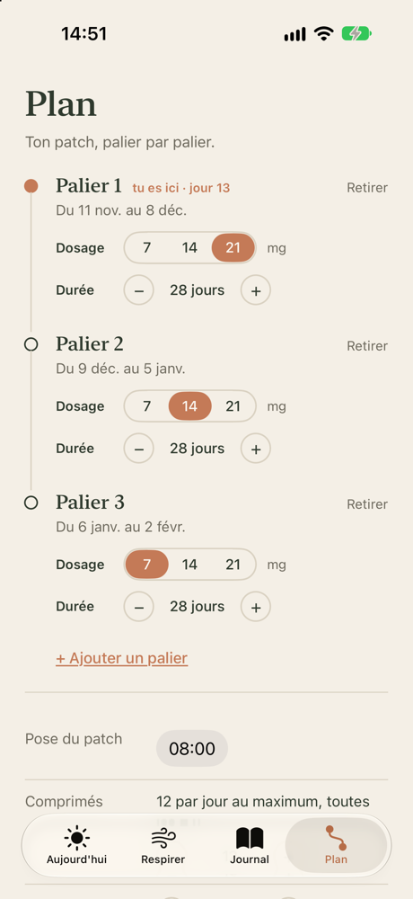

<div align="center">



# NoSmoke

**A quit-smoking companion for people on nicotine patches.**
Track the patch, pace the lozenges, ride out the cravings. No account, no server, no streak shaming.


[](LICENSE)

<table>
<tr>
<td width="25%"></td>
<td width="25%"></td>
<td width="25%"></td>
<td width="25%"></td>
</tr>
<tr>
<td align="center"><sub><strong>Today</strong></sub></td>
<td align="center"><sub><strong>Breathe</strong></sub></td>
<td align="center"><sub><strong>Journal</strong></sub></td>
<td align="center"><sub><strong>Plan</strong></sub></td>
</tr>
</table>

</div>

## Why

Nicotine replacement works best when it is used properly: a fresh patch every morning on a new spot, a step down every few weeks, and lozenges spaced out instead of chained. That is a lot of small bookkeeping on top of the hard part. NoSmoke does the bookkeeping, then gets out of the way.

The app is in French. The code and docs are in English.

## What's inside

- **Today.** How long since the last cigarette, how many you didn't smoke and what that kept in your pocket. Super Patch tells you whether today's patch is on and suggests where the next one goes, rotating through six sites so the skin gets a rest.
- **Lozenges, paced.** One tap per lozenge, a daily cap you set, and a two-hour recharge ring between doses. Micro, the little carrier, gets visibly loaded as the day fills up.
- **Breathe.** A craving usually passes within minutes. A ten-minute paced breathing timer (in 4 s, out 6 s) and a short list of things to do with your hands until it does.
- **Journal.** Log a craving in two taps: how strong (five clouds, from wisp to thunderstorm) and what set it off. After a few days, it shows when your cravings cluster and what triggers them most. A slip is logged as a fact, not a failure: the counter restarts and that's it.
- **Plan.** The usual 21 → 14 → 7 mg taper, four weeks each, fully editable. A reminder at patch time every morning, and another when a new step starts.
- **Widgets.** Home Screen (small, medium) and Lock Screen (circular, rectangular): day count, patch status, lozenges left.
- **Something growing.** A plant in a pot grows with the days, a piggy bank fills with the money kept, the lungs recover milestone by milestone.

## Privacy

Everything stays on the phone. There is no network code at all: no analytics, no crash reporter, no sync. The state is one small JSON file in the app's App Group container, shared with the widget and nothing else. Delete the app and it's gone.

## Build it

Requires Xcode 16 or later and [XcodeGen](https://github.com/yonaskolb/XcodeGen). The Xcode project is generated, not committed.

```bash
brew install xcodegen
xcodegen generate
open NoSmoke.xcodeproj
```

Set your own signing team (`DEVELOPMENT_TEAM` in `project.yml`) and, if you are not me, your own bundle ID and App Group: the app and the widget must share the group, or the widget stays empty. Then run the `NoSmoke` scheme on a device or simulator.

## Layout

```
NoSmoke/          The app: Today, Breathe, Journal, Plan, onboarding, reminders
NoSmokeWidgets/   WidgetKit extension: Home Screen and Lock Screen widgets
Shared/           Model, persistence, the "Jardin" theme, and the characters
Shared/Characters Super Patch, Micro, the craving clouds, the garden — all drawn in SwiftUI
NoSmokeTests/     Unit tests for the taper logic
design/           HTML mockups and icon studies the UI was built from
project.yml       XcodeGen spec, the source of truth for the Xcode project
```

No third-party dependencies. The characters are vector drawings in SwiftUI, not image assets, so they animate and scale freely.

## Contributing

Bug reports and pull requests are welcome. See [CONTRIBUTING.md](CONTRIBUTING.md).

## Not medical advice

NoSmoke is a tracking tool, not a medical device. Doses, durations and health milestones shown in the app are general information. Follow the leaflet that came with your patches and talk to a doctor or pharmacist about your own plan. In France, [Tabac Info Service](https://www.tabac-info-service.fr) (39 89) offers free support.

## License

[MIT](LICENSE)
